  

# Hello World! 🌍

  

---

### 📖 About Me

- 🎓 Graduated from **IT STEP Academy** in 2021.
- 💻 Completed software engineering coursework at **Holberton School**.
- 🔍 Passionate about software development, debugging, and building clean tools.
- 📍 Based in **Azerbaijan**.

---

### 🚀 Projects

- 📌 **[holbertonschool-ai4devs](https://github.com/parvinaslanov/holbertonschool-ai4devs)** — Repository housing software engineering projects, tech specifications, and product design files.

---

### 📊 GitHub Metrics

  

---

